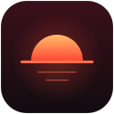
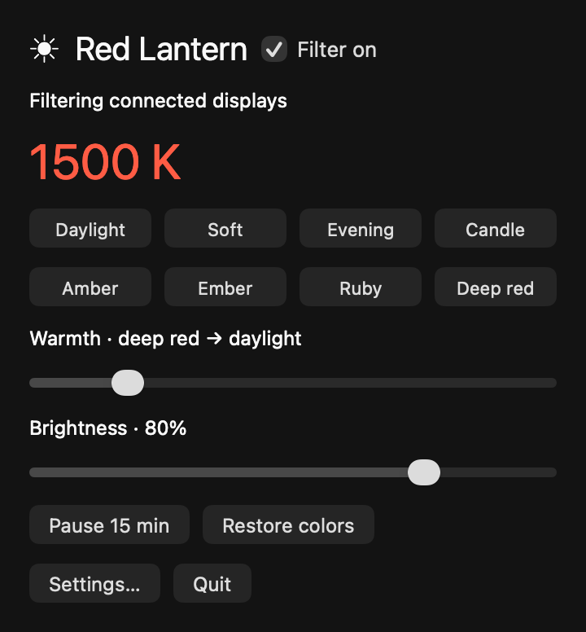

<p align="center">
  
</p>

<h1 align="center">Red Lantern</h1>

<p align="center">
  <strong>Warm your screen. Turn down the glow. Settle into the evening.</strong><br>
  A free, native macOS menu-bar utility with red-only filtering and offline scheduling.
</p>

<p align="center">
  <a href="https://github.com/andreaparker/red-lantern/actions/workflows/checks.yml"></a>
  
  <a href="LICENSE"></a>
</p>

<p align="center">
  <a href="https://github.com/andreaparker/red-lantern/releases/latest/download/Red-Lantern-macOS-universal.zip"><strong>⬇ Download Red Lantern for Mac</strong></a><br>
  macOS 14+ · Apple silicon &amp; Intel · Free<br>
  <sub>Ad-hoc signed; not Apple-notarized. <a href="#get-started">First-open instructions</a> · <a href="https://github.com/andreaparker/red-lantern/releases/latest">Release notes &amp; checksums</a></sub>
</p>

<p align="center">
  <a href="#get-started">Get started</a> ·
  <a href="#choose-your-light">Presets</a> ·
  <a href="#set-it-and-leave-it">Scheduling</a> ·
  <a href="SECURITY.md">Security</a>
</p>

---

Choose a gentle evening tint, add software dimming, or go fully red. Red Lantern lives in your menu bar and keeps your settings local. No subscription, account, or location permission required.

<p align="center">
  
  <br>
  <sub>The app’s actual native controls, rendered with example settings.</sub>
</p>

## What you get

| | |
| --- | --- |
| **Eight presets** | Move from neutral daylight through candle and amber tones to red-only output. |
| **Software dimming** | Adjust brightness independently of your display’s brightness keys. |
| **Offline schedules** | Switch manually, set clock times, or follow local sunset and sunrise. |
| **Quick access** | Control the filter from the menu bar; open the full window when you need settings. |
| **Color restoration** | Restore instantly, on Quit, or before sleep. A small helper provides crash recovery. |
| **A small native app** | Swift, AppKit, and a tiny C helper. No runtime packages to install. |

## Get started

1. **[Download the Mac app](https://github.com/andreaparker/red-lantern/releases/latest/download/Red-Lantern-macOS-universal.zip)** — one ZIP for Apple silicon and Intel, macOS 14 or later. No build tools required.
2. Double-click the ZIP, then drag **Red Lantern.app** to **Applications**.
3. Open it from Applications. Use the horizon icon in your menu bar for Quick Controls.

**First open:** this release has a local ad-hoc signature, **not a Developer ID signature or Apple notarization**. macOS may block the initial launch. If you trust this download, try opening it once, then use **System Settings → Privacy & Security → Open Anyway** for Red Lantern. Follow [Apple’s instructions](https://support.apple.com/en-us/102445); leave Gatekeeper enabled.

To pin its launcher, right-click its Dock icon and choose **Options → Keep in Dock**. Checksums are available on the [release page](https://github.com/andreaparker/red-lantern/releases/latest).

<details>
<summary>Prefer to build from source?</summary>

Install Apple Command Line Tools (`xcode-select --install`), then:

```sh
git clone https://github.com/andreaparker/red-lantern.git
cd red-lantern
./build.sh
open "build/Red Lantern.app"
```

`./build.sh` builds for your Mac’s architecture. `./release.sh` builds both architectures, verifies signatures after ZIP extraction, and writes the download and SHA-256 checksum to `build/release/`. Both use ad-hoc signing. You don’t need the full Xcode application or a paid developer account.

</details>

## Choose your light

Click a preset, then fine-tune **Warmth** and **Brightness**. Sliders apply when released, keeping display updates to a minimum. Selecting a preset preserves your schedule.

| Preset | Approximate warmth | Brightness |
| --- | ---: | ---: |
| Daylight | 6500 K | 100% |
| Soft | 4500 K | 100% |
| Evening | 3400 K | 95% |
| Candle | 2700 K | 90% |
| Amber | 2000 K | 85% |
| Ember | 1500 K | 80% |
| Ruby | 1000 K | 75% |
| Deep red | 500 K | 70% |

Warmth labels describe a visual color curve, not calibrated blackbody spectra. **Deep red zeros the green and blue output tables.**

## Set it and leave it

Open **Settings** from the menu-bar panel and choose a schedule:

- **Manual:** keep the filter on until you turn it off.
- **Clock:** choose start and end times, including overnight intervals. Identical times keep filtering off.
- **Sunset:** enter latitude and longitude once and enable **Use these coordinates**. Sunset and sunrise are calculated locally; north/east are positive and south/west are negative.

Turn on **Filter on** to arm the schedule. **Open at login** is optional.

## Close the window. Keep the filter.

The red **close** button closes the settings window and hides the running Dock icon. The menu-bar controls, active filter, and schedule keep running. Choose **Settings** from the horizon icon to reopen the window.

| Action | Result |
| --- | --- |
| **Pause 15 min** | Temporarily restore normal colors, then resume. |
| **Restore colors** | Turn filtering off immediately. |
| **⌃⌥⌘R** | Emergency restore shortcut: Control + Option + Command + R. |
| **Quit** | Restore the captured display colors and fully exit. |

Sleep restores colors; wake reapplies the active setting. The recovery helper also attempts restoration if the main app crashes.

## Built to stay quiet

Red Lantern adjusts the display’s color table through public Core Graphics APIs.

- **No repeating timer in manual mode**, whether filtering is on or off.
- Clock and solar schedules use a **single timer for the next transition**.
- Unchanged settings do not rewrite display tables.
- Display, sleep/wake, and clock notifications handle system changes without polling.
- Native controls are created when opened and released when closed.
- The recovery helper blocks on a pipe and does not run for neutral daylight.

## Private by design

The app has **no networking code, accounts, analytics, or third-party runtime libraries**. Preferences and any coordinates you enter stay in local user defaults.

[Build and security checks](https://github.com/andreaparker/red-lantern/actions/workflows/checks.yml) run on every push and pull request: regression tests, C static security analysis, sanitizer checks, a native build, signature verification, and a full-history secret scan. See [the security policy](SECURITY.md) for scope and private vulnerability reporting.

## Display compatibility

Some display drivers, HDR/reference modes, or competing color utilities can override gamma-table adjustments. For predictable output, turn off **Night Shift**, **True Tone**, and other screen-color tools while using Red Lantern.

Crash recovery depends on the helper and display driver remaining usable.

### Does it stop screen flicker?

**No. Red Lantern is a color and software-dimming utility, not an anti-flicker tool.** It does not disable backlight PWM, GPU/panel temporal dithering, or flashing content. We have tested color-table changes, but have not measured the screen’s optical flicker or clinically tested neurological benefits.

Red-only output is not a photosensitivity safety guarantee: **saturated red flashing** has specific risks described in [W3C’s accessibility guidance](https://www.w3.org/WAI/WCAG22/Understanding/three-flashes-or-below-threshold.html). The app does not detect or suppress such content. See [flicker limitations and verification scope](docs/flicker.md).

## Contributing

Bug reports, display-compatibility reports, and small improvements are welcome. Include your macOS version, Mac architecture, and display model when relevant; keep personal data out of public reports.

Run the core checks before submitting a change:

```sh
./test.sh
./build.sh
```

The executable’s `--display-test` option also checks live gamma changes and recovery. It **briefly changes screen colors** before restoring them, so run it when that won’t interrupt your work:

```sh
"build/Red Lantern.app/Contents/MacOS/RedLantern" --display-test
```

Implementation starts in [`Sources/`](Sources). The bounded recovery protocol is in [`Tools/Guardian.c`](Tools/Guardian.c), with malformed-input tests in [`Tests/guardian_protocol.py`](Tests/guardian_protocol.py).

## License

[MIT](LICENSE). Free to use, modify, and share.
